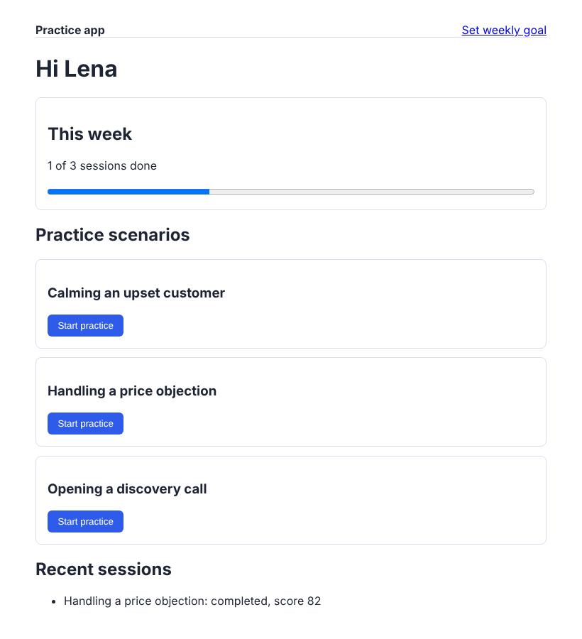

# agent-product-tester

A small practice app for sales and service reps, one feature shipped through it end to end, and a browser agent that tests the product the way a user would: it reads the page, clicks and types through tool calls, and then the run is checked against the data the app wrote, including the tracking events analytics depends on.



## Why

UI tests usually check that a page loads. The bugs that hurt a product team are quieter: a form that accepts a value it should refuse, a progress bar that counts the wrong thing, a tracking event that fires twice so every dashboard built on it is off. This repo tests journeys through a real browser and then looks at the database and the event stream, so those bugs fail the run.

## What is in it

**The app** (`app/`, FastAPI, Jinja, SQLite). Sign in, pick a scenario, write an answer, get a score with tips, see weekly progress. The data model has accounts, users, scenarios, sessions, goals and an `events` table with the same columns as the raw event stream in [product-metrics-layer](https://github.com/Akshitaa-V/product-metrics-layer), so app data can be loaded into the metrics warehouse as it is.

**The feature: weekly practice goal.** Built through every layer: `goals` table → routes with server-side validation (1 to 14) → form and dashboard progress bar with a "goal reached" state → `goal_set` tracking event → covered by unit tests and three browser journeys.

**The agent** (`qa/`). Five tools, described as JSON schemas: `snapshot` (accessibility tree), `click` (by role and accessible name), `fill` (by label), `check_text`, `finish`. Two policies drive them:

- `GuidedPolicy` follows the steps in a journey file but still finds every element through the same role, name and label lookups. It is deterministic and runs in CI without an API key.
- `LLMPolicy` gives a model the persona, the goal and the tool schemas, sends every tool result back with its `tool_call_id`, and lets the model decide what to do next. It works with any model LiteLLM supports.

**Journeys** (`qa/journeys/*.yml`). Seven of them, each with a persona, a goal, steps and data checks:

```yaml
checks:
  - events: {session_started: 1, session_completed: 1, feedback_viewed: 1}
  - name: session stored as completed with a score
    sql: "select count(*) from sessions where user_id = :user_id and status = 'completed' and score is not null"
    equals: 1
```

Every run also fails on any HTTP 5xx the browser saw. When the agent says it passed but the data disagrees, the data wins (`test_data_checks_overrule_an_optimistic_agent`).

## Results

The app ships with five known bugs that can be switched on one at a time (`--bug`). `python -m qa matrix` runs every journey against the clean app and against each bug:

- 7/7 journeys pass on the clean app.
- 5/5 planted bugs are caught, in 42 browser runs taking about 48 s.
- Two of the five are tracking bugs that look fine on screen: a missing `feedback_viewed` event and a duplicated `session_completed`. Only the event checks catch them.

| Bug | Caught by |
|---|---|
| Goal form accepts 0 or negative values | 03_invalid_goal_rejected |
| Opening feedback does not send `feedback_viewed` | 01, 05, 07 (event counts) |
| Weekly progress also counts abandoned sessions | 04_abandon_session |
| Answers over 400 characters crash on submit | 05_long_answer (and a 500 is recorded) |
| Submitting sends `session_completed` twice | 01, 05, 07 (event counts) |

33 tests: app and data model, scoring, all journeys, every planted bug, and the LLM loop driven by a scripted model in the OpenAI tool-calling format (tool results returned with matching ids, bad tool names and malformed arguments returned to the model as errors it can recover from).

## Run it

```bash
pip install -r requirements.txt
python -m playwright install chromium

python -m app                         # http://127.0.0.1:8000, sign in as lena@demo.test
python -m app --bug double_completed_event

python -m pytest -q                   # 33 tests
python -m qa run                      # all journeys, clean app
python -m qa run --bug goal_no_validation
python -m qa matrix                   # writes reports/bug_matrix.md and .json

# LLM-driven run (set your provider key first, e.g. OPENAI_API_KEY)
python -m qa llm 02_set_weekly_goal --model gpt-4o-mini
python -m qa llm 04_abandon_session --bug progress_counts_abandoned --headed
```

## Limits

- The guided policy is the one that runs in CI. The LLM policy is tested for its loop and message handling with a scripted model, not for how well a particular model explores; that depends on the model and costs tokens per run.
- The scorer is a few rules (keywords, an open question, length). It is there so the flow has something real to show, not as a coaching model.
- One browser (Chromium), no mobile viewport yet.
